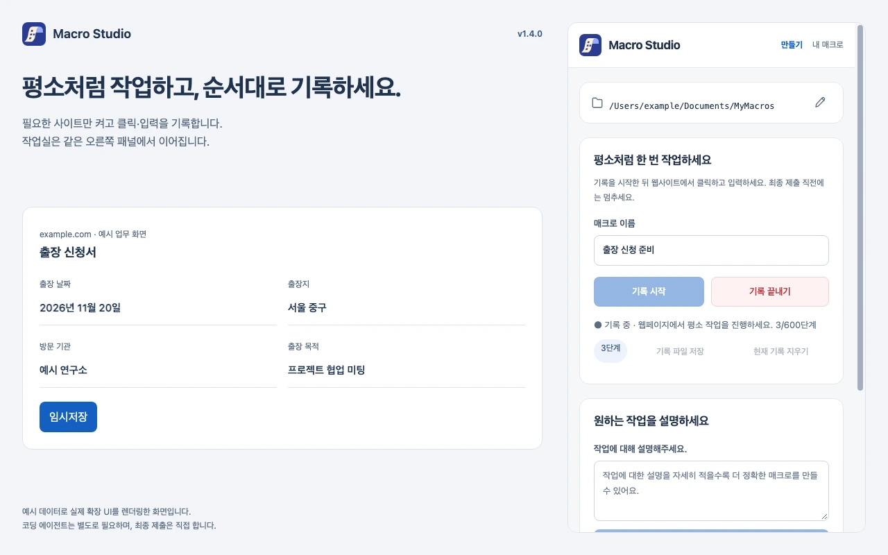

# Macro Studio

Chrome에서 반복하는 클릭과 입력을 기록해 Codex나 Claude Code에 건네세요. 만든 매크로는 쓰던 사이트에서 실행하고, 자주 쓰는 입력값은 잠그거나 숨겨둘 수 있어요.

**[Macro Studio 홈페이지](https://macro-studio.pages.dev/)**

1. 사용할 사이트를 켜고, 사용 준비에서 폴더 읽기·쓰기와 실행 권한을 확인하세요.
2. 평소처럼 작업을 기록하고 설명을 적어 코딩 에이전트용 지시문을 복사하세요.
3. 연결 폴더에 저장된 매크로를 실행하세요. 입력별 잠금·숨김과 이름 수정은 공통 실행 화면에서 관리합니다.

v1.4.0 업데이트 제출을 준비한 화면입니다. 현재 스토어 게시 버전과 심사 상태는 스토어에서 확인하세요.

[Chrome 웹 스토어](https://chromewebstore.google.com/detail/oobgpakpaoknojmgkolgmmkjemjmimld) · [사용 가이드](docs/getting-started.md) · [데이터와 권한](docs/privacy.md) · [개발 가이드](docs/DEVELOPMENT.md) · [업데이트 제출](docs/chrome-web-store.md)
