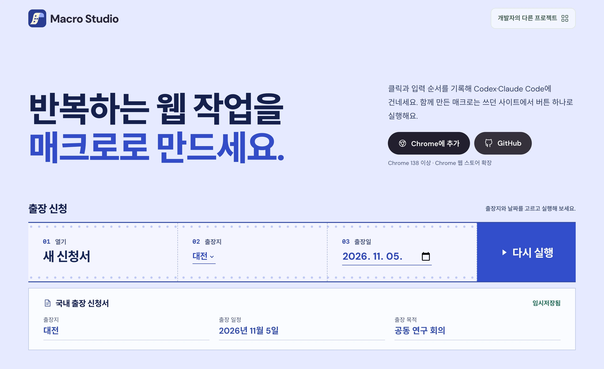

# Macro Studio

Chrome에서 반복하는 클릭과 입력을 기록해 Codex나 Claude Code에 건네세요. 함께 만든 매크로는 쓰던 사이트에서 버튼 하나로 다시 실행할 수 있어요.

**[출장 신청 매크로 실행해 보기 ↗](https://macro-studio.pages.dev/)**

[Chrome 웹 스토어](https://chromewebstore.google.com/detail/oobgpakpaoknojmgkolgmmkjemjmimld) · [사용 가이드](docs/getting-started.md) · [데이터와 권한](docs/privacy.md) · [개발 가이드](docs/DEVELOPMENT.md)
