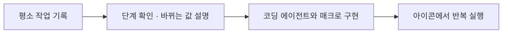

# macro-studio

**작업을 보여주면, 나만의 매크로가 됩니다.**

Record a workflow. Build your own browser macro with a coding agent.

[](https://github.com/hoonably/macro-studio/actions/workflows/check.yml)
[](LICENSE)

Macro Studio는 반복하는 웹 작업을 개인 매크로로 만드는 Chrome 확장 프로그램입니다.
평소에는 작은 아이콘으로 두고, 필요한 스크립트와 날짜 같은 값을 골라 실행합니다.
새 작업은 직접 수행하면서 기록한 뒤, **Codex 또는 Claude Code에 기록과 `AGENTS.md`를 전달해 구현**합니다.
만들어진 매크로는 실행할 때마다 AI를 호출하지 않습니다.



## 지금 가능한 것

- 도구모음 팝업에서 사이트별 ON/OFF, 파란 버튼의 새 자동화 만들기로 작업실 열기
- 드래그할 수 있는 작은 아이콘, 스크립트 목록, 입력값 선택, 진행 상태와 중복 실행 방지
- 별도 스크립트 보관함에서 보관·복원·목록 삭제, 새로고침 후 상태 유지
- 일반 DOM 입력·선택·클릭 어댑터와 SAP Web Dynpro 어댑터
- 사이드패널의 클릭·입력·화면 이동 기록, 단계 삭제, 바뀌는 값 설명
- 현재 탭의 내부 프레임 주소 자동 감지, 필요한 사이트만 선택해 추가 권한 허용
- 검토한 기록을 JSON 또는 에이전트용 프롬프트로 내보내기
- 개인 스크립트 생성 명령과 자동 빌드·등록
- 스크립트 폴더 연결, 저장 후 자동 갱신과 열린 페이지의 실행 버튼 반영
- UNIST 출장 흐름을 참고할 수 있는 개발용 예제 소스

**현재 AI 연결 방식은 프롬프트 전달입니다.** 확장 안의 Codex·Claude 채팅, 로컬 companion 설치, 자동 코드 적용은 아직 구현하지 않았습니다. [확장 계획](docs/roadmap.md)을 참고하세요.

## 설치

Node.js 22 이상과 Chrome 135 이상이 필요합니다.

```bash
git clone https://github.com/hoonably/macro-studio.git
cd macro-studio
npm ci
npm run build
```

1. Chrome에서 `chrome://extensions`를 엽니다.
2. **개발자 모드 → 압축해제된 확장 프로그램을 로드**를 누릅니다.
3. 이 저장소의 **`dist` 폴더**를 선택합니다. 로드한 폴더는 계속 유지하세요.
4. 도구모음의 **Macro Studio** 아이콘을 누르면 작은 팝업이 열립니다. **이 사이트에 적용**을 ON으로 켜세요.
5. 페이지에 나타난 파란 버튼 → **새 자동화 만들기**를 누르면 오른쪽에 작업실이 열립니다.

처음 설치하면 스크립트 목록은 비어 있고 모든 사이트는 OFF입니다. UNIST 출장 예제도 자동 설치되지 않습니다. 필요한 작업을 기록해 개인 스크립트를 만들어 추가하세요.

개인 스크립트를 만들 때는 팝업의 **스크립트 연결·관리** 또는 작업실의 **스크립트 연결**을 엽니다. 저장소 폴더 또는 `local/scripts`를 한 번 선택하고, 안내가 나오면 Chrome의 **사용자 스크립트 허용**을 켜세요. 이후 그 폴더에 코드를 저장하면 확장 관리 화면을 열지 않아도 목록과 실행 버튼이 갱신됩니다. 새 사이트는 선택해 한 번 허용합니다. Chrome 135–137에서는 개발자 모드가 사용자 스크립트를 허용합니다.

기존 UNIST 도우미를 쓰고 있다면, 새 확장을 테스트할 때 기존 확장을 꺼서 아이콘과 작업이 중복되지 않게 하세요. 기존 폴더는 복구용으로 보관해도 됩니다.

자주 쓰지 않는 스크립트는 목록 오른쪽의 보관 아이콘을 누르고 확인 팝업에서 확인해 옮기세요. **스크립트 보관함**은 페이지의 아이콘 메뉴에서 열 수 있습니다. 보관함에서 복원하거나 삭제할 수 있으며, 삭제한 항목은 확장 화면에서 되돌릴 수 없습니다. 저장소의 원본 파일과 개인 설정은 유지됩니다.

## 나만의 매크로 만들기

1. 자동화할 사이트에 직접 로그인합니다.
2. 도구모음 팝업에서 **이 사이트에 적용 ON** → 페이지의 **파란 버튼 → 새 자동화 만들기** → 작업실의 **새 기록 시작**을 누릅니다. 다른 출처의 내부 화면도 기록하려면 자동 감지를 켜고 필요한 주소를 허용합니다.
3. 평소 하던 순서대로 작업한 뒤 **기록 끝내기**를 누릅니다.
4. 기록한 단계를 확인하고 불필요하거나 전달하지 않을 단계를 삭제합니다.
5. 목적과 ‘바뀌는 값’을 적고, 항상 표시되는 전달 내용을 검토한 뒤 **에이전트용 프롬프트 복사**를 누릅니다. 단계마다 설정할 필요 없이 에이전트가 설명을 기준으로 실행 입력을 만듭니다.
6. Codex·Claude Code에서 이 저장소를 열어 프롬프트를 붙여 넣습니다. 에이전트는 [AGENTS.md](AGENTS.md)를 참고해 개인 스크립트를 만듭니다.
7. 에이전트가 `npm run verify`로 확인한 뒤, 연결된 폴더의 변경사항이 자동 반영됩니다. 개인 스크립트만 바꿨다면 확장을 새로고침할 필요가 없습니다.

콘솔에서 먼저 읽기 전용으로 화면 구조를 조사하는 방법도 지원합니다. [스크립트 제작 안내](docs/create-script.md)

```bash
npm run new:script -- weekly-task --name "매주 하는 작업" --url https://example.com
```

개인 파일은 `local/scripts/weekly-task/`에 생성되고 Git에 포함되지 않습니다. 생성한 템플릿의 실행 부분을 실제 작업에 맞게 구현해야 합니다. 연결된 폴더에서는 메타데이터와 명시한 실행 파일만 읽어 등록합니다. 빌드에는 현재 개인 스크립트의 사본도 포함되므로 폴더 연결 전의 기존 사용 방식도 유지됩니다.

작업실·동기화 화면이 보이면 약 2초마다, 닫혀 있어도 약 30초 간격으로 변경을 확인합니다. Chrome의 절전·종료 중에는 확인이 늦어집니다. 잘못된 파일은 마지막 정상 버전을 유지하며, 실행 중에는 변경 적용을 미룹니다. 폴더 읽기 권한이 만료되면 동기화 화면에서 다시 허용하세요. [동기화 안내](docs/script-sync.md)

## UNIST 출장 예제

`scripts/examples/unist-travel/`과 `profiles/unist.json`은 개발용 참고 소스입니다. 기본 빌드에 포함하거나 실행 목록에 등록하지 않습니다. 필요한 경우 에이전트에게 이 소스와 [UNIST 동작 범위](docs/unist.md)를 참고해 `local/scripts/<id>/`에 개인 스크립트를 만들도록 요청하세요. 개인값과 필요한 파일의 로드 순서도 해당 스크립트에서 명시해야 합니다.

이 예제는 **관내출장·기타/자비** 조합을 기준으로 합니다. 다른 출장 유형이나 재원은 실제 폼을 확인해 코드를 확장해야 합니다.
저장된 결재선을 선택하고 순서가 맞는지 확인한 뒤 멈춥니다. **최종 결재상신은 사용자가 직접 누릅니다.** [UNIST 설정·동작 범위](docs/unist.md)

## 프로젝트 구조

```text
extension/                 공통 실행 기능, 아이콘, 사이드패널, 기록기
  adapters/                일반 DOM / SAP
profiles/                  사이트별 로드 범위와 진입점 참고 자료
scripts/examples/          개발용 예제 소스 (기본 설치 제외)
templates/script/          개인 스크립트 템플릿
tools/                     빌드, 생성, 읽기 전용 진단
local/                     개인 설정·스크립트·진단 자료 (Git 제외)
docs/                      설치, 제작, 문제 해결, 확장 계획
tests/                     오프라인 검증
dist/                      개인용 빌드 (Git 제외)
dist-public/               공유용 빌드 (Git 제외)
AGENTS.md                  코딩 에이전트용 제작 규칙
CLAUDE.md                  공통 규칙 참조
```

## 개발과 공유

```bash
npm run verify          # 문법·개인값 분리 검사, 테스트, 두 종류 빌드
npm run build           # local/scripts의 개인 스크립트 포함; 없으면 빈 목록
npm run build:public    # local/을 읽지 않는 공유용 빌드
```

작은 수정마다 버전을 올릴 필요는 없습니다. 개인 스크립트 변경은 연결된 폴더에서 자동 반영됩니다. 공통 확장 기능·manifest를 변경했다면 다시 빌드한 뒤 `chrome://extensions`의 새로고침 버튼을 누르고 작업 페이지도 새로고침하세요. 버전은 배포 단위로 관리합니다.

공유할 때는 **`dist-public`만** 사용하세요. `dist`에는 개인 입력값과 스크립트가 들어갈 수 있습니다.
기록은 브라우저 세션 동안 로컬에 보관하며, 비밀번호·인증번호 필드를 건너뜁니다. 일반 입력·페이지 제목에는 개인 정보가 남을 수 있으므로 내보낼 내용을 확인하세요. [데이터와 권한](docs/privacy.md)

테스트는 실제 포탈을 조작하거나 상신하지 않는 오프라인 검사입니다. 새로운 사이트·Chrome 환경에서는 사용자가 실제 화면에서 확인해야 합니다.

[설치·사용법](docs/getting-started.md) · [스크립트 제작](docs/create-script.md) · [구조](docs/architecture.md) · [문제 해결](docs/troubleshooting.md) · [기여](CONTRIBUTING.md)

MIT License
